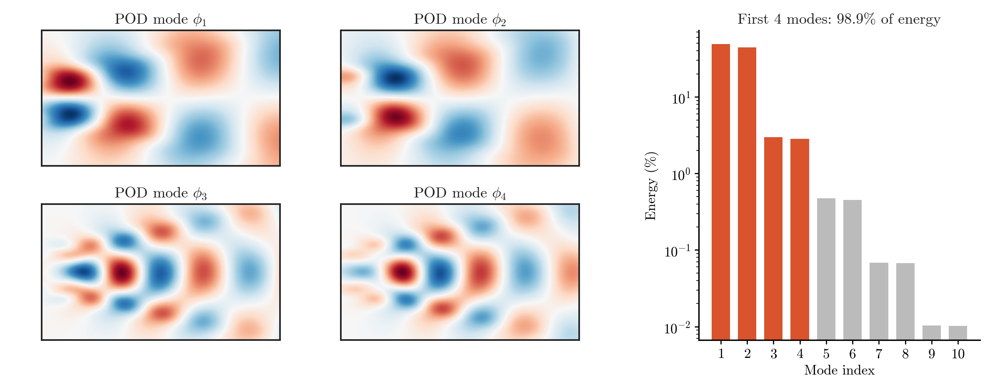
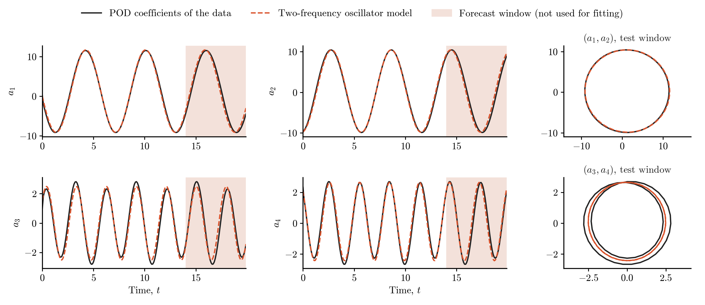
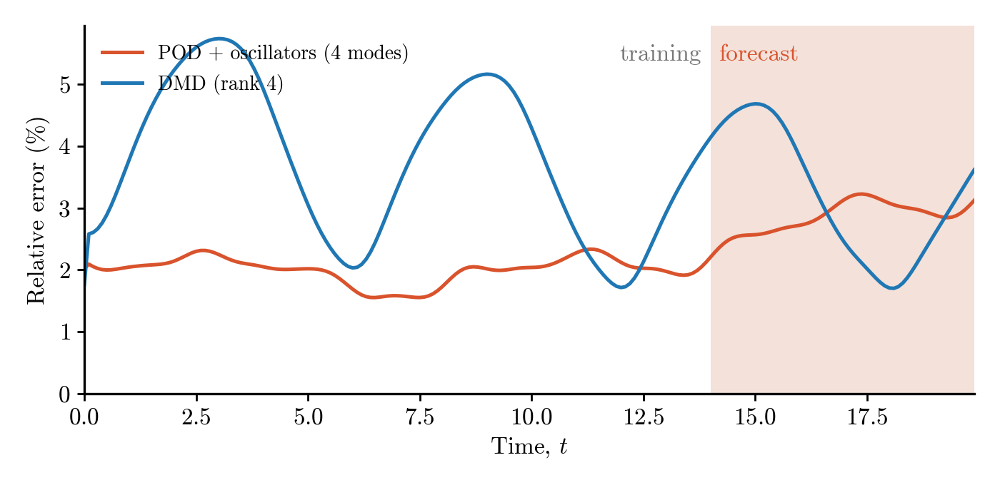

This project compares two classic reduced-order models for predicting the 2D cylinder wake from simulation snapshots of the streamwise velocity. Both models are trained on the first 70% of the snapshots and then asked to forecast the remaining 30%, which they never see.

<figure>
  <video src="/images/pod-dmd/pod-dmd-comparison.mp4" poster="/images/pod-dmd/pod-dmd-comparison.png" autoplay loop muted playsinline></video>
  <figcaption>Ground truth, POD-oscillator forecast and DMD forecast of the streamwise velocity, with the absolute error of each model. The clip starts at the end of the training window and runs through the forecast.</figcaption>
</figure>

## POD with oscillator coefficients

POD on the training window gives the dominant spatial modes. The first four modes come in two pairs and hold 98.9% of the fluctuation energy: one pair for the shedding frequency and one for its first harmonic.

<figure>
  
  <figcaption>The first four POD modes and the energy of the first ten modes. The four modes used in the model are in orange.</figcaption>
</figure>

Each pair of temporal coefficients traces a circle, so its frequency can be read from the phase of the pair. I estimate the two frequencies from the training data, fit each coefficient with a sinusoid at its pair's frequency, and then evaluate the sinusoids in the forecast window. The whole model is fourteen numbers: two frequencies and an offset and two amplitudes per coefficient.

<figure>
  
  <figcaption>POD coefficients of the data and the two-frequency oscillator model. Right: phase portraits of the two coefficient pairs in the forecast window.</figcaption>
</figure>

## DMD

The DMD model (rank 4) is trained on the same window. It finds a low-rank linear operator that advances the flow by one time step, and its modes and eigenvalues are used to roll the flow forward and predict the forecast snapshots directly.

## Comparison

In the forecast window the mean relative error is 2.8% for the POD-oscillator model and 3.2% for DMD. The POD model's error grows slowly as small phase errors build up. The DMD error swings between about 2% and 5% with the shedding cycle, a pattern it already shows in the training window.

<figure class="fig-narrow">
  
  <figcaption>Relative error of the two models over the training window and the forecast window (shaded).</figcaption>
</figure>

Both models give a clean, interpretable baseline for periodic flows. The code and the mathematical formulation are on my **[GitHub](https://github.com/MRDanesh/POD_DMD)**.
