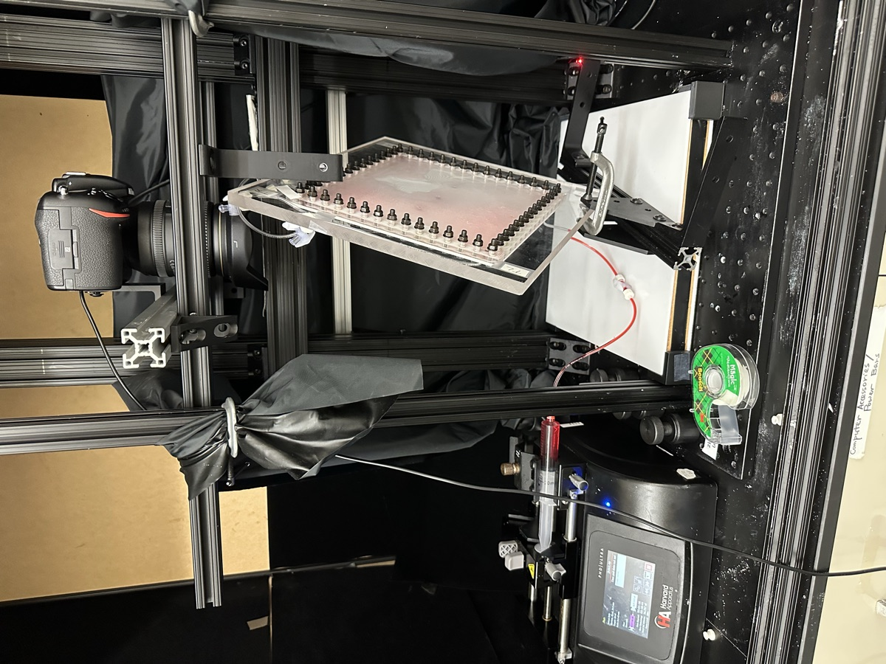

*Ongoing research at McMaster University.*

How fast a contaminant can be flushed out of the ground depends on a permeability field that we cannot see. In this project we study contaminant removal in a five-spot setup: clean fluid is injected at the centre and pushes the contaminant towards four corner outlets that can each be opened or closed. We run the experiments in a transparent cell whose engraved gap sets the permeability, and the simulations in OpenFOAM.

<figure class="fig-narrow">
  
  <figcaption>The experimental setup.</figcaption>
</figure>

<figure>
  <video src="/images/porous-flow/video_exp_vs_scaled_fit1_openfoam.mp4" width="780" autoplay loop muted playsinline></video>
  <figcaption>Validation of the numerical solver: the experiment (left) and the OpenFOAM simulation (right).</figcaption>
</figure>

The goal is a digital twin that learns the hidden geology from a few sensors while the experiment runs, and then uses it to choose the injection rate and the open outlets so that the contaminant is removed with as little water as possible. It has two parts. A Fourier neural operator (FNO) predicts how the contaminant moves, much faster than the full simulation, and a recurrent network estimates the permeability map and its uncertainty from the sensor readings. Together they will drive a model predictive controller.

<figure>
  <video src="/images/porous-flow/portfolio_sample.mp4" width="900" autoplay loop muted playsinline></video>
  <figcaption>A run in which the injection rate and the open outlets change over time: OpenFOAM, the FNO prediction and their difference, with the outlet signals and the removed fraction below.</figcaption>
</figure>
