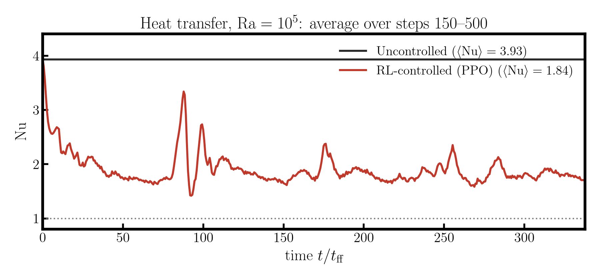

In Rayleigh–Bénard convection a fluid layer is heated from below and cooled from above. Above a critical Rayleigh number, warm fluid rises and cold fluid sinks in convection rolls, which carry far more heat than conduction alone. Following **[Beintema et al.](https://doi.org/10.1080/14685248.2020.1797059)**, I asked whether a reinforcement-learning agent that only rearranges the temperature along the heated plate, while keeping its mean temperature fixed, can weaken this convection.

I coupled a custom OpenFOAM 9 solver with a PPO agent written in Python and PyTorch. The bottom plate is split into ten segments, and each action makes every segment hotter or colder than nominal. The agent sees the temperature and velocity at 8 × 8 probes and is rewarded for a lower Nusselt number. Training runs 64 OpenFOAM simulations in parallel on one workstation.

<figure>
  <video src="/images/rl/rb_Ra1e5_side_by_side.mp4" width="900" autoplay loop muted playsinline></video>
  <figcaption>Uncontrolled (left) and RL-controlled (right) convection at Ra = 105, from the same initial state. Colour is the dimensionless temperature, lines are streamlines, and the strip under each cavity is the bottom-plate temperature chosen by the agent.</figcaption>
</figure>

The agent roughly halves the heat transfer at both Rayleigh numbers tested (−53% at Ra = 104 and −52% at Ra = 105). At Ra = 104 it breaks the convection roll and keeps the fluid almost at rest, so heat moves by conduction. At Ra = 105 it turns the single roll into two stacked counter-rotating cells, a warm one below and a cold one above, and heat then has to cross the shear layer between them by conduction. Beintema et al. reported the same double-cell structure.

<figure class="fig-narrow">
  
  <figcaption>Nusselt number in time for the run in the video. Control starts at t = 0.</figcaption>
</figure>

I am now extending the controller to yield-stress fluids, in which convection starts only once buoyancy overcomes the yield stress. The goal is the reverse problem: use the same zero-mean plate fluctuations to trigger and sustain flow in a fluid that would otherwise stay at rest. The viscoplastic solver is already validated against published benchmarks.

The code is available on my **[GitHub](https://github.com/MRDanesh/pyOpenFoam)**.
