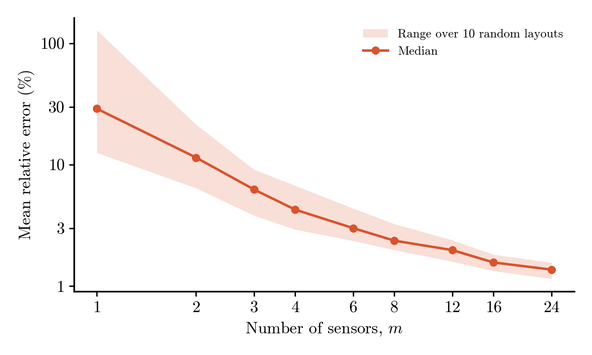
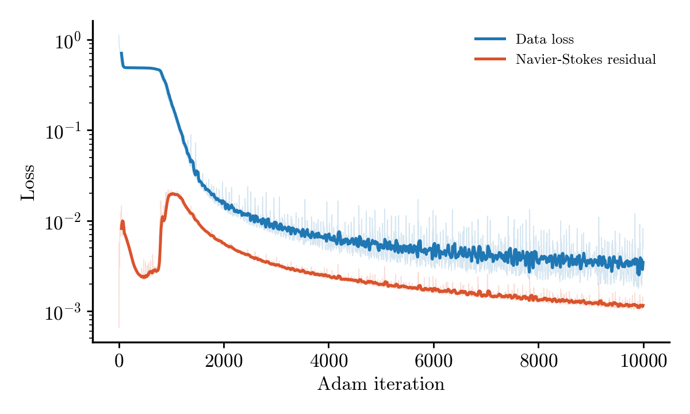

This project compares two ways of reconstructing a full flow field from sparse sensor measurements, using the 2D incompressible cylinder wake. The first is a sparse snapshot method rooted in compressed sensing. The second is a physics-informed neural network (PINN) that enforces the Navier–Stokes equations during training.

## Sparse snapshot reconstruction

The sparse method writes each new snapshot as a combination of a few previously observed snapshots. A LASSO problem picks those snapshots from the sensor readings alone. I built the snapshot library from the first half of the simulation (t = 0 to 9.9) and reconstructed the second half (t = 10 to 19.9), which the method never sees. With 8 randomly placed sensors and 2% measurement noise, the mean relative error of the speed field is 2.0%, and it stays below 5% at every time step.

<figure>
  <video src="/images/sparse-pinns/sparse-reconstruction.mp4" poster="/images/sparse-pinns/sparse-reconstruction.png" autoplay loop muted playsinline></video>
  <figcaption>Speed field on unseen snapshots: ground truth, reconstruction from 8 sensors (white dots), and absolute error. The bottom strip shows the relative error over time.</figcaption>
</figure>

The error depends mostly on how many sensors are available. One sensor gives errors around 30%, three sensors bring it below 10%, and beyond 8 sensors the gain is small.

<figure class="fig-narrow">
  
  <figcaption>Mean relative error on the unseen snapshots against the number of sensors, over 10 random sensor layouts.</figcaption>
</figure>

The method is fast and easy to interpret, and it works well when the new flow looks like the training data. It is still an interpolation, though, and it does not enforce any physical law.

## Physics-informed neural network

The PINN maps space and time to velocity and pressure. It is trained to match measurements at 30 points and to satisfy the Navier–Stokes equations at 30 other points where no data are given. The network has 9 hidden layers of 20 neurons and is trained for 10,000 Adam iterations.

<figure>
  <video src="/images/sparse-pinns/pinn-reconstruction.mp4" poster="/images/sparse-pinns/pinn-reconstruction.png" autoplay loop muted playsinline></video>
  <figcaption>Speed (top) and pressure (bottom) from the PINN against the ground truth. Circles are measured points; crosses are points where only the Navier–Stokes residual is enforced.</figcaption>
</figure>

The PINN captures the vortex street well downstream. The near wake, just behind the cylinder, is harder: the mean error is 8.7% for speed and larger for pressure. Both losses are still falling at the end of training, so a longer run or a second-order optimizer should improve the result.

<figure class="fig-narrow">
  
  <figcaption>Data loss and Navier–Stokes residual during training.</figcaption>
</figure>

Comparing the two shows the trade-off between fast, data-driven interpolation and physics-informed learning when a dynamical system is observed at only a few points. The code and the mathematical formulation are on my **[GitHub](https://github.com/MRDanesh/Sparse_PINNs)**.
